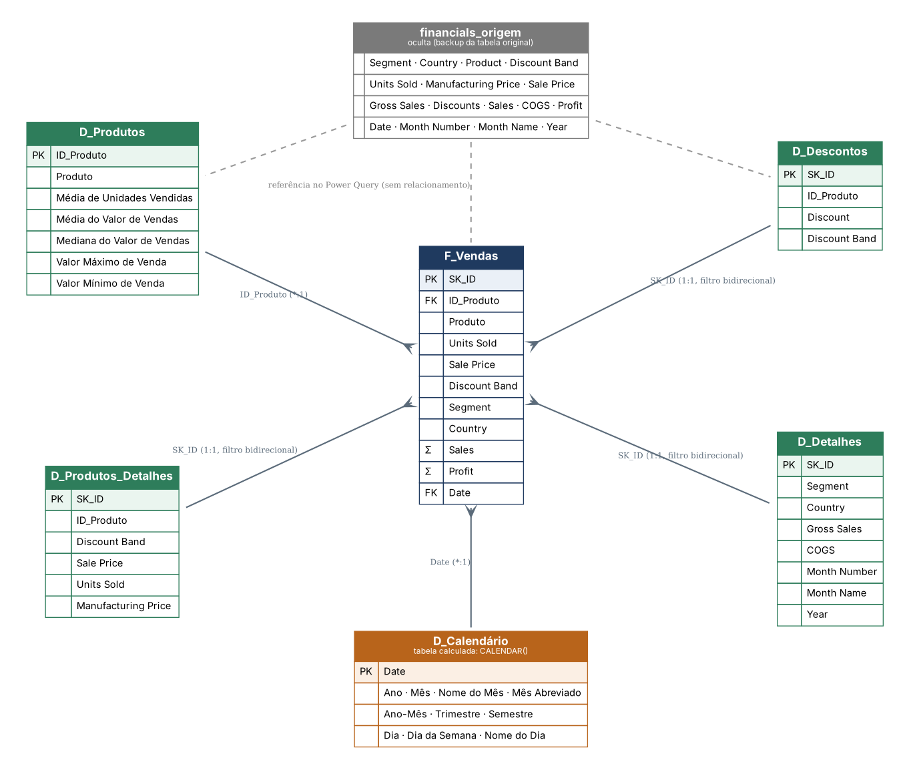
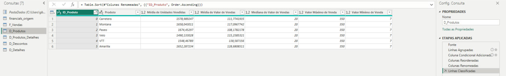
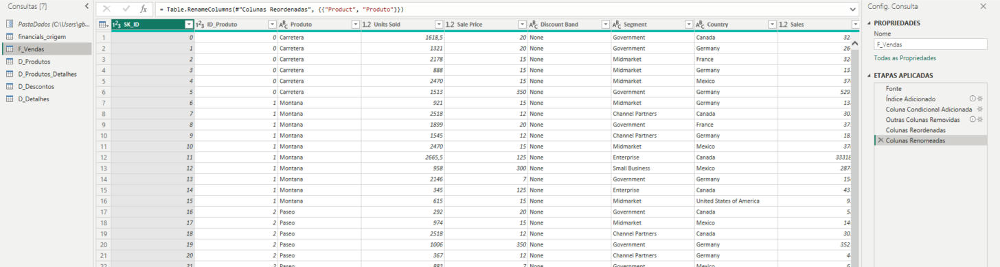
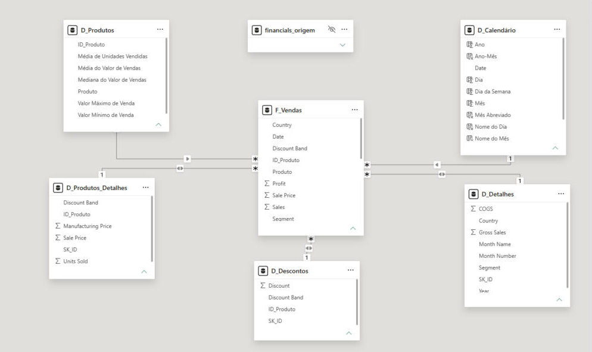
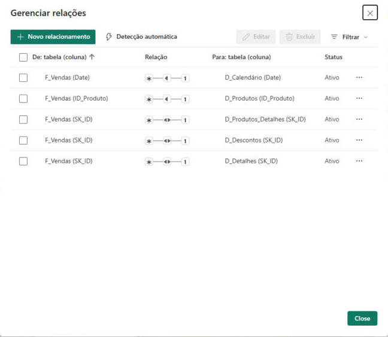
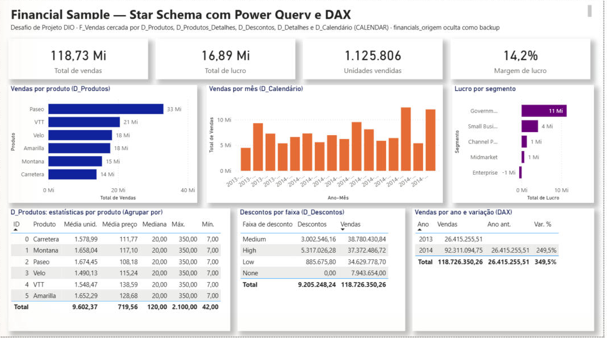

# Desafio de Projeto DIO — Modelagem e Transformação de Dados com DAX no Power BI

Quinto desafio de projeto da formação **Power BI Analyst** da [DIO](https://www.dio.me/): partir da tabela única **Financial Sample** e construir um **star schema** no Power BI, criando as tabelas dimensão e fato a partir de cópias da tabela original (Power Query), uma dimensão de calendário em **DAX** com `CALENDAR()` e medidas DAX para a análise.



## Arquivos

| Pasta / arquivo | Conteúdo |
|---|---|
| `financial_sample_star_schema_dax.pbix` | Projeto do Power BI com as sete tabelas, relacionamentos, D_Calendário em DAX, 13 medidas e a página **Análise de vendas** |
| `diagrama/` | Diagrama do star schema (`star_schema.png`, `.svg` e a fonte `.dot` do Graphviz) |
| `dados/Financial Sample.xlsx` | Tabela única de origem (amostra financeira da Microsoft usada no curso) |
| `power-query/` | Código M de cada tabela (`*.pq`) e o DAX da tabela calculada, das colunas calculadas e das medidas (`calendario_e_medidas.dax`) |
| `pbip/` | O modelo semântico em TMDL (`model.tmdl`, `relationships.tmdl`, `tables/*.tmdl`), legível no GitHub, e o projeto completo (TMDL + PBIR) em `financial_sample_star_schema_dax_pbip.zip` |
| `prints/` | Modelo no Power BI, janela de relacionamentos, etapas aplicadas no Power Query e página de análise |
| `enunciado/` | As três imagens de referência do enunciado (Agrupar por, coluna condicional e colunas reorganizadas) |

## O processo de construção

A Financial Sample tem 700 linhas e 16 colunas (segmento, país, produto, faixa de desconto, unidades, preços, vendas, custo, lucro e data). Tudo foi feito a partir dela, em quatro passos:

1. **Carga e backup.** A tabela `financials` do Excel entra como `financials_origem`. Ela recebe apenas a correção do cabeçalho (` Sales` vinha com um espaço à esquerda) e os tipos de dados, e fica **oculta** no modelo (`isHidden`), servindo de backup e de fonte para as outras consultas.
2. **Dimensões e fato por referência.** Cada tabela nova é uma consulta que começa com `Fonte = financials_origem` (referência, não duplicação, então qualquer ajuste na origem se propaga) e seleciona só as colunas da sua visão.
3. **Chaves.** Como a tabela original não tem chaves, elas foram criadas no Power Query: `SK_ID`, um **índice** sequencial que identifica cada venda, e `ID_Produto`, uma **coluna condicional** que numera os seis produtos (Carretera 0, Montana 1, Paseo 2, Velo 3, VTT 4, Amarilla 5).
4. **Calendário e medidas em DAX.** `D_Calendário` é uma tabela calculada com `CALENDAR()`, enriquecida com colunas calculadas, e as medidas de análise ficam em `F_Vendas`.

## As tabelas

| Tabela | Como foi criada | Colunas |
|---|---|---|
| **financials_origem** (oculta) | Excel → `Table.TransformColumnNames(Text.Trim)` → tipos | As 16 colunas originais |
| **D_Produtos** | **Agrupar por** `Product` (modo avançado) com cinco agregações, depois coluna condicional `ID_Produto`, colunas reordenadas e renomeadas | `ID_Produto`, `Produto`, `Média de Unidades Vendidas`, `Média do Valor de Vendas`, `Mediana do Valor de Vendas`, `Valor Máximo de Venda`, `Valor Mínimo de Venda` |
| **D_Produtos_Detalhes** | Índice `SK_ID` + condicional `ID_Produto` + seleção de colunas | `SK_ID`, `ID_Produto`, `Discount Band`, `Sale Price`, `Units Sold`, `Manufacturing Price` |
| **D_Descontos** | Índice + condicional + seleção, `Discounts` renomeada para `Discount` | `SK_ID`, `ID_Produto`, `Discount`, `Discount Band` |
| **D_Detalhes** | Índice + seleção das informações que as outras dimensões não cobrem | `SK_ID`, `Segment`, `Country`, `Gross Sales`, `COGS`, `Month Number`, `Month Name`, `Year` |
| **D_Calendário** | DAX: `CALENDAR()` + colunas calculadas | `Date`, `Ano`, `Mês`, `Nome do Mês`, `Mês Abreviado`, `Ano-Mês`, `Trimestre`, `Semestre`, `Dia`, `Dia da Semana`, `Nome do Dia` |
| **F_Vendas** | Índice + condicional + seleção, `Product` renomeada para `Produto` | `SK_ID`, `ID_Produto`, `Produto`, `Units Sold`, `Sale Price`, `Discount Band`, `Segment`, `Country`, `Sales`, `Profit`, `Date` |

Sobre `D_Detalhes (*)`: o enunciado pede para verificar o que não foi contemplado nas outras dimensões. Sobraram o segmento, o país, as vendas brutas, o custo (COGS) e os campos de mês e ano da tabela original; é isso que ela carrega. O campo "Salers" da lista de `F_Vendas` foi interpretado como `Sales`, já que a Financial Sample não tem vendedor.

### Agrupar por (D_Produtos)

É a etapa **Linhas Agrupadas** da consulta, feita com *Agrupar por* em modo avançado: agrupa por `Product` e calcula média de `Units Sold`, média, mediana, máximo e mínimo de `Sale Price`. Em M:

```m
#"Linhas Agrupadas" = Table.Group(Fonte, {"Product"}, {
    {"Média de Unidades Vendidas", each List.Average([Units Sold]), type nullable number},
    {"Média do Valor de Vendas",   each List.Average([Sale Price]), type nullable number},
    {"Mediana do Valor de Vendas", each List.Median([Sale Price]),  type nullable number},
    {"Valor Máximo de Venda",      each List.Max([Sale Price]),     type nullable number},
    {"Valor Mínimo de Venda",      each List.Min([Sale Price]),     type nullable number}})
```

Resultado (6 linhas): Carretera vende em média 1.579 unidades a 111,77; Paseo 1.674 a 108,18; VTT 1.548 a 138,59; a mediana de preço é 20 para todos, com mínimo 7 e máximo 350.



### Coluna condicional e reorganização (F_Vendas e detalhes)

A coluna `ID_Produto` é a etapa **Coluna Condicional Adicionada**: `se Product = "Carretera" então 0, senão se Montana então 1 ... senão se Amarilla então 5`. Depois dela vêm **Outras Colunas Removidas** (só as colunas da visão) e **Colunas Reordenadas** (`SK_ID` e `ID_Produto` primeiro, como no exemplo do enunciado). O índice `SK_ID` é a etapa **Índice Adicionado** (`Table.AddIndexColumn`, começando em 0), aplicada na mesma ordem de linhas em todas as consultas, por isso o mesmo `SK_ID` identifica a mesma venda em `F_Vendas`, `D_Produtos_Detalhes`, `D_Descontos` e `D_Detalhes`.



## Relacionamentos



| Relacionamento | Cardinalidade | Filtro |
|---|---|---|
| `F_Vendas[ID_Produto]` → `D_Produtos[ID_Produto]` | muitos para um | único |
| `F_Vendas[Date]` → `D_Calendário[Date]` | muitos para um | único |
| `F_Vendas[SK_ID]` → `D_Produtos_Detalhes[SK_ID]` | um para um (chave da venda) | ambas as direções |
| `F_Vendas[SK_ID]` → `D_Descontos[SK_ID]` | um para um | ambas as direções |
| `F_Vendas[SK_ID]` → `D_Detalhes[SK_ID]` | um para um | ambas as direções |

As três tabelas de detalhe têm uma linha por venda, então a chave é o `SK_ID`. O filtro bidirecional nelas permite que uma medida como `Total de Descontos` (que soma `D_Descontos[Discount]`) responda aos filtros aplicados em `F_Vendas`, por exemplo o produto escolhido em `D_Produtos`. `financials_origem` não tem relacionamento com ninguém: é só o backup.



## DAX

### Tabela calculada D_Calendário

```dax
D_Calendário =
CALENDAR(DATE(YEAR(MIN(F_Vendas[Date])), 1, 1), DATE(YEAR(MAX(F_Vendas[Date])), 12, 31))
```

`CALENDAR()` gera uma linha por dia entre as duas datas. Em vez de `MIN` e `MAX` diretos, o intervalo é fechado em **anos inteiros** (01/01/2013 a 31/12/2014), o que as funções de inteligência temporal precisam para funcionar bem. As colunas calculadas usam `YEAR`, `MONTH`, `DAY`, `WEEKDAY`, `IF` e `FORMAT`:

```dax
Ano = YEAR([Date])
Mês = MONTH([Date])
Nome do Mês = FORMAT([Date], "MMMM")        -- ordenada por Mês (Classificar por coluna)
Mês Abreviado = FORMAT([Date], "MMM")
Ano-Mês = FORMAT([Date], "yyyy-MM")
Trimestre = "T" & FORMAT([Date], "Q")
Semestre = IF(MONTH([Date]) <= 6, 1, 2)
Dia = DAY([Date])
Dia da Semana = WEEKDAY([Date], 2)
Nome do Dia = FORMAT([Date], "dddd")        -- ordenada por Dia da Semana
```

### Medidas (em F_Vendas)

| Medida | Expressão | Função usada |
|---|---|---|
| Total de Vendas | `SUM(F_Vendas[Sales])` | `SUM` |
| Total de Lucro | `SUM(F_Vendas[Profit])` | `SUM` |
| Unidades Vendidas | `SUM(F_Vendas[Units Sold])` | `SUM` |
| Qtd de Vendas | `COUNTROWS(F_Vendas)` | `COUNTROWS` |
| Margem de Lucro | `DIVIDE([Total de Lucro], [Total de Vendas])` | `DIVIDE` (evita divisão por zero) |
| Ticket Médio | `DIVIDE([Total de Vendas], [Qtd de Vendas])` | `DIVIDE` |
| Preço Médio de Venda | `AVERAGE(F_Vendas[Sale Price])` | `AVERAGE` |
| Total de Descontos | `SUM(D_Descontos[Discount])` | `SUM` em outra tabela (filtro bidirecional) |
| Vendas Brutas | `SUM(D_Detalhes[Gross Sales])` | `SUM` |
| Custo Total (COGS) | `SUM(D_Detalhes[COGS])` | `SUM` |
| Vendas Ano Anterior | `CALCULATE([Total de Vendas], SAMEPERIODLASTYEAR('D_Calendário'[Date]))` | `CALCULATE` + `SAMEPERIODLASTYEAR` |
| Vendas Acumuladas no Ano | `TOTALYTD([Total de Vendas], 'D_Calendário'[Date])` | `TOTALYTD` |
| Variação vs Ano Anterior | `DIVIDE([Total de Vendas] - [Vendas Ano Anterior], [Vendas Ano Anterior])` | `DIVIDE` |

Os totais batem com a planilha: vendas 118.726.350,26; lucro 16.893.702,26; 1.125.806 unidades; descontos 9.205.248,24; margem 14,2%.

## Página de análise



A página **Análise de vendas** usa as medidas e as dimensões para validar o modelo: cartões (vendas, lucro, unidades, margem), vendas por produto (`D_Produtos`), vendas por mês (`D_Calendário[Ano-Mês]`), lucro por segmento, a tabela de estatísticas de `D_Produtos` (resultado do Agrupar por), descontos por faixa (`D_Descontos`, via filtro bidirecional) e vendas por ano com `Vendas Ano Anterior` e a variação (2014 cresceu 249,5% sobre 2013, que só tem de setembro a dezembro).

## Como abrir

1. Baixe `financial_sample_star_schema_dax.pbix` e abra no Power BI Desktop. Os dados já estão carregados.
2. Para atualizar a partir do Excel, baixe `dados/Financial Sample.xlsx` e, em **Transformar dados > Gerenciar parâmetros**, aponte `PastaDados` para a pasta onde ele está.

## Referência

Repositório do curso, com a Financial Sample e os arquivos das aulas: [julianazanelatto/power_bi_analyst](https://github.com/julianazanelatto/power_bi_analyst)
